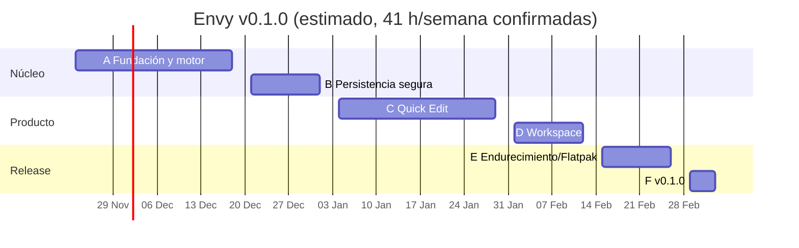

# Envy v0.1.0 — Roadmap

> **Estado:** plan v2 (2026-11-20), replanificado con 41 h/semana confirmadas (D-02). Aprobado por el usuario (2026-11-25); las fechas siguen siendo **estimadas**, no comprometidas.  
> **Fuentes:** [`docs/PRD.md`](../PRD.md) v1.1 (alcance) y [`docs/TECHNICAL_DESIGN.md`](../TECHNICAL_DESIGN.md) v1.1 (implementación).  
> **Documentos:** [BACKLOG](BACKLOG.md) (tareas) · [SPRINT_PLAN](SPRINT_PLAN.md) (calendario) · [MILESTONES](MILESTONES.md) (hitos) · [RISKS](RISKS.md) · [DEFINITION_OF_DONE](DEFINITION_OF_DONE.md) · [DECISIONS](DECISIONS.md) · [TASK_TEMPLATE](TASK_TEMPLATE.md)

> **Progreso (2026-11-25):** S01–S05 completados (31 de 88 tareas en `Done`): motor dotenv, historial, almacenamiento seguro, sesión, monitor y matriz de guardado seguro. Todavía no hay UI. Detalle en [SPRINT_PLAN §6](SPRINT_PLAN.md#6-progreso-real).

## 1. Estado de partida (confirmado)

- Repositorio con Git inicializado, **sin commits** y sin código: solo `docs/PRD.md` y `docs/TECHNICAL_DESIGN.md`.
- Por tanto, todas las estimaciones parten de cero (sin código reutilizable) y el primer sprint incluye la creación del crate.

## 2. Alcance

### 2.1 MVP v0.1.0 (PRD §5: P0 + P1 + P2)

- **P0 (seguridad/corrección):** parser sin pérdida (ENV-001), edición de asignaciones con comillas y multilínea (ENV-002), sintaxis desconocida preservada como `Raw` (ENV-003), guardado protegido (ENV-004), monitoreo y conflictos (ENV-005).
- **P1 (experiencia esencial):** Quick Edit por CLI y diálogo (ENV-006), búsqueda (ENV-007), crear/eliminar (ENV-008), undo/redo (ENV-009), pegado con previsualización (ENV-010), copiar (ENV-011), ocultación de secretos (ENV-012), estados (ENV-013), atajos y accesibilidad (ENV-020).
- **P2 (Workspace):** proyectos (ENV-014), servicios (ENV-015), descubrimiento (ENV-016), etiquetas de entorno (ENV-017), comparación con `.env.example` (ENV-018), duplicados (ENV-019).
- **Transversal:** seguridad y privacidad (PRD §8), Flatpak con mínimos privilegios (PRD §9, TD §12), i18n preparada, metadatos, README y licencia (PRD §11 hito 4, §14).
- **Requisito derivado propuesto:** protección al cerrar con cambios sin guardar (PRD §10, D-16).

### 2.2 Exclusiones (PRD §2.2, TD §16)

Sin cuentas/nube/sincronización; sin SSH/Docker/Kubernetes/CI/CD/proveedores de secretos; sin ejecución de comandos ni expansión de shell; sin drag & drop ni reordenamiento; sin iconos por servicio, histórico persistente ni comparación valor a valor; sin escaneo recursivo; sin respaldos automáticos; sin merge de tres vías; sin recursos remotos/GVfs garantizados; sin diálogo de preferencias (propuesta D-28).

## 3. Fases y calendario estimado

| Fase | Sprints | Fechas | Horas plan | Resultado | Hito |
|---|---|---|---|---|---|
| A — Fundación y motor de documentos | S01–S04 | 2026-11-23 → 2026-12-18 | 123 | Especificación, parser/serializador/codec/comandos/historial probados; spikes de guardado y Flatpak; S04 inicia la persistencia | M1 2026-12-18 |
| B — Persistencia segura y conflictos | S05–S06 | 2026-12-21 → 2027-01-01 | 50 | Guardado condicionado, monitor, pegado, matrices de prueba (semanas festivas) | M2 2027-01-01 |
| C — Quick Edit | S07–S10 | 2027-01-04 → 2027-01-29 | 123 | `envy .env` completo en nativo; S10 inicia el Workspace | M3 2027-01-29 |
| D — Workspace y herramientas de entorno | S11–S12 | 2027-02-01 → 2027-02-12 | 60 | Navegación, sesiones, etiquetas, comparación; S12 audita A11y y crea el manifiesto Flatpak | M4 2027-02-12 |
| E — Endurecimiento y distribución | S13–S14 | 2027-02-15 → 2027-02-26 | 50 | Metadatos, i18n, Flatpak validado, regresión nativa, documentación y RC | M5 y M6 2027-02-26 |
| F — Release | S15 | 2027-03-01 → 2027-03-05 | 11 | Regresión del RC, go/no-go, publicación (holgura 21,8 h para correcciones) | M7 2027-03-05 |
| **Total** | **15** | **2026-11-23 → 2027-03-05** | **417** | | |

Las horas por fase se cuentan por sprint; con 41 h/semana algunos sprints mezclan el final de una fase con el inicio de la siguiente (indicado en la columna *Resultado* y en [SPRINT_PLAN §3](SPRINT_PLAN.md#3-resumen-de-sprints)).

## 4. Capacidad (resumen)

- **Capacidad bruta: 41 h/semana, confirmada por el usuario** (D-02 resuelta). Reserva del 20 % mantenida (D-35) => **32,8 h netas**; semanas del 25-dic y 1-ene con un día menos (32,8 h brutas / 26,24 h netas). Ver [SPRINT_PLAN §1–2](SPRINT_PLAN.md#1-supuestos-de-capacidad).
- **Esfuerzo:** 417 h en 88 tareas (sin cambios respecto al plan v1) · capacidad neta en 15 sprints: 478,88 h · utilización 87,1 % · holgura 61,88 h (más la reserva del 20 %: 119,72 h brutas).
- **Por qué 15 sprints y no 13:** 417 / 32,8 = 12,7 semanas teóricas, pero (a) las tareas no se parten entre sprints, (b) las dependencias y las puertas de aprobación obligan a esperar decisiones, y (c) se deja una semana entre el RC (S14) y la publicación (S15) para la evaluación go/no-go.
- **Sostenibilidad:** 41 h/semana con un único desarrollador es el principal riesgo de calendario (R-17). Sensibilidad: con 24 h netas/semana reales (30 h brutas), el release pasaría a ~principios de abril de 2027.

## 5. Dependencias y ruta crítica

### 5.1 Cadena de dependencias más larga (98 h)

Calculada sobre el grafo de dependencias del backlog:

`ENV-T002 → ENV-T004 → ENV-T008 → ENV-T009 → ENV-T010 → ENV-T011 → ENV-T014 → ENV-T016 → ENV-T019 → ENV-T029 → ENV-T036 → ENV-T040 → ENV-T042 → ENV-T082 → ENV-T083 → ENV-T084 → ENV-T085 → ENV-T076 → ENV-T087`

Es decir: esqueleto → errores sin secretos → modelo → lexer → parser una línea → multilínea → ValueCodec → SetValue → historial → sesión → EditorView → Guardar en UI → conflictos en UI → validación Flatpak → documentación → lint Flathub → RC → go/no-go → publicación.

### 5.2 Lectura para un único desarrollador

Con una sola persona y WIP = 1, **la duración la fija sobre todo la capacidad (417 h / 32,8 h por semana)**: todas las tareas se ejecutan en serie. Con 41 h/semana gana peso un segundo factor: **la latencia de las decisiones del usuario**, porque cada spike o especificación debe aprobarse antes del sprint siguiente (puertas de aprobación en [SPRINT_PLAN §2](SPRINT_PLAN.md#2-verificación-aritmética)). El grafo determina el **orden** y qué no se puede adelantar. Las cadenas que no admiten retrasos sin mover hitos son:

1. **Motor** (S01–S04): ENV-T006 → ENV-T008 → ENV-T009 → ENV-T010 → ENV-T011 → ENV-T014 → ENV-T016 → ENV-T019. Todo lo demás depende de él. **D-11 debe aprobarse entre el fin de S01 y el inicio de ENV-T010 en S02** (1–2 días de margen).
2. **Guardado seguro** (S02 → S08): ENV-T025 (S02) → ENV-T027 (S04) → ENV-T028/ENV-T030 (S05) → ENV-T040/ENV-T042 (S08). D-12 debe estar decidida el 2026-12-21.
3. **Workspace en Flatpak** (S03 → S13): ENV-T054 (S03) → ENV-T055 (S10) → ENV-T056/ENV-T057 → ENV-T059/ENV-T060 (S11) → ENV-T082 (S13). D-19 debe estar decidida el 2027-01-25.
4. **Release** (S12 → S15): ENV-T077 (S12) → ENV-T082 (S13) → ENV-T083/ENV-T084/ENV-T085 (S14) → ENV-T076 → ENV-T087 (S15), con D-07 (app ID, 2027-02-08) y D-08 (licencia, 2027-02-22) como puertas.

**Cambios respecto al plan v1 (15 h/semana):** la cadena de dependencias no cambia (mismas tareas y mismas dependencias). Cambia el calendario: todas las fechas límite de decisiones se adelantan (de 2 semanas en D-11 a más de 5 meses en D-08), y varias caen en las semanas festivas (D-12, D-27, D-34 el 2026-12-21; D-05, D-06, D-09, D-15, D-28, D-33 el 2027-01-04). Ver [MILESTONES §2](MILESTONES.md#2-puertas-de-decisión-fechas-límite).

### 5.3 Qué bloquea a qué

| Bloque | Bloquea a | Motivo |
|---|---|---|
| Especificación de sintaxis (ENV-T006) + D-11 | Todo E2 y E3 | Reglas de parser y codec |
| Errores sin secretos (ENV-T004) | Modelo, almacenamiento, UI, catálogo | Política de redacción desde el primer tipo |
| Historial (ENV-T019) + puerto (ENV-T026) | Sesión (ENV-T029) | La sesión compone historial y almacenamiento |
| Sesión (ENV-T029) | Toda la UI de edición (ENV-T035, ENV-T036, ENV-T041…) | La UI solo habla con la sesión (regla TD §1) |
| Guardado (ENV-T028/ENV-T030) | Guardar en UI (ENV-T040) → conflictos (ENV-T042) → cierre (ENV-T044) | |
| Spike Flatpak (ENV-T054) + D-19 | Catálogo (ENV-T055) → todo Workspace; manifiesto (ENV-T077) | |
| Workspace (ENV-T060, ENV-T061) + conflictos (ENV-T042) | Validación Flatpak (ENV-T082) | El flujo TD §12 recorre ambos |
| D-07 app ID | ENV-T033 (recomendado), ENV-T077, ENV-T078, ENV-T079, ENV-T084 | Identificador en todos los artefactos |

### 5.4 Trabajo independiente (reordenable sin romper dependencias)

ENV-T003 (CI núcleo), ENV-T015 (ejemplo roundtrip), ENV-T022 (heurística de secretos), ENV-T024 (inferencia de etiquetas), ENV-T071 (guion manual), ENV-T074 (línea base de rendimiento), ENV-T079 (icono, solo depende de D-07). Son los candidatos a mover si un sprint necesita hueco.

## 6. Principales riesgos de calendario

Ver [RISKS.md §1](RISKS.md#1-top-5-riesgos-de-calendario): R-17 sostenibilidad de 41 h/semana, R-08 latencia de decisiones (agravada por el ritmo y los festivos), R-04 parser/codec, R-02 Flatpak, R-01 garantía de guardado.

## 7. Siguiente paso

Este roadmap (v2, 41 h/semana) requiere aprobación del usuario del alcance, del resto de supuestos y de las decisiones de DG-1 y DG-2 (D-11 antes del 2026-11-30). Hasta entonces **no** se inicia el Sprint 1 ni se delega implementación.
